# SIGEST - Diagrama Entidade-Relação

Gerado automaticamente a partir dos modelos Django (`scripts/gerar_der.py`).
Para ver o diagrama no VS Code, instale a extensão *Markdown Preview Mermaid Support*.

```mermaid
erDiagram
    core_Tecnologia {
        BigAutoField id PK
        DateTimeField criado_em
        DateTimeField atualizado_em
        CharField nome
    }
    core_Notificacao {
        BigAutoField id PK
        DateTimeField criado_em
        DateTimeField atualizado_em
        ForeignKey destinatario FK
        CharField titulo
        TextField mensagem
        CharField url
        BooleanField lida
    }
    core_RegistoDecisao {
        BigAutoField id PK
        ForeignKey utilizador FK
        CharField nome_utilizador
        CharField accao
        CharField referencia
        TextField detalhe
        DateTimeField criado_em
    }
    contas_Utilizador {
        BigAutoField id PK
        CharField password
        DateTimeField last_login
        BooleanField is_superuser
        CharField username
        CharField first_name
        CharField last_name
        BooleanField is_staff
        BooleanField is_active
        DateTimeField date_joined
        CharField email
        CharField tipo
    }
    estudantes_Curso {
        BigAutoField id PK
        DateTimeField criado_em
        DateTimeField atualizado_em
        CharField nome
        CharField sigla
    }
    estudantes_PerfilEstudante {
        BigAutoField id PK
        DateTimeField criado_em
        DateTimeField atualizado_em
        OneToOneField utilizador FK
        CharField numero_estudante
        ForeignKey curso FK
        PositiveSmallIntegerField ano_frequencia
        DecimalField media_geral
        CharField registo_estado
        TextField registo_motivo
        ForeignKey registo_decidido_por FK
        DateTimeField registo_decidido_em
        TextField resumo
        FileField curriculo
        CharField estado
    }
    estudantes_DocumentoEstudante {
        BigAutoField id PK
        DateTimeField criado_em
        DateTimeField atualizado_em
        ForeignKey estudante FK
        CharField tipo
        FileField ficheiro
    }
    empresas_Empresa {
        BigAutoField id PK
        DateTimeField criado_em
        DateTimeField atualizado_em
        OneToOneField utilizador FK
        CharField nome
        CharField nif
        CharField tipo
        CharField sector
        CharField telefone
        CharField endereco
        BooleanField nif_validado
        DateTimeField validado_em
    }
    empresas_Orientador {
        BigAutoField id PK
        DateTimeField criado_em
        DateTimeField atualizado_em
        OneToOneField utilizador FK
        ForeignKey empresa FK
        CharField cargo
    }
    vagas_Vaga {
        BigAutoField id PK
        DateTimeField criado_em
        DateTimeField atualizado_em
        ForeignKey empresa FK
        CharField titulo
        TextField descricao
        TextField requisitos
        PositiveSmallIntegerField numero_vagas
        CharField localizacao
        CharField modalidade
        PositiveSmallIntegerField duracao_meses
        DateField data_limite
        CharField estado
        TextField motivo_devolucao
        CharField area
        CharField tipo_estagio
        TextField documentos_exigidos
        BooleanField fase_teste
        BooleanField fase_curriculo
        BooleanField fase_entrevista
    }
    candidaturas_Candidatura {
        BigAutoField id PK
        DateTimeField criado_em
        DateTimeField atualizado_em
        ForeignKey estudante FK
        ForeignKey vaga FK
        CharField estado
        TextField mensagem
        TextField feedback
        DateField data_inicio
        DateField data_fim
        DecimalField avaliacao_final
        ForeignKey orientador FK
        DateTimeField inicio_confirmado_empresa
        DateTimeField inicio_confirmado_estudante
        DateTimeField interrompido_em
        TextField motivo_interrupcao
        ForeignKey interrompido_por FK
        DateTimeField concluida_em
        BooleanField efectivado
        DateTimeField efectivado_em
    }
    candidaturas_RegistoDiario {
        BigAutoField id PK
        CharField estado
        TextField comentario_orientador
        ForeignKey validado_por FK
        DateTimeField validado_em
        DateTimeField criado_em
        DateTimeField atualizado_em
        ForeignKey candidatura FK
        DateField data
        TextField descricao
        TextField competencias
        TextField observacoes
    }
    candidaturas_RelatorioEstagio {
        BigAutoField id PK
        CharField estado
        TextField comentario_orientador
        ForeignKey validado_por FK
        DateTimeField validado_em
        DateTimeField criado_em
        DateTimeField atualizado_em
        ForeignKey candidatura FK
        CharField tipo
        CharField titulo
        TextField conteudo
    }
    candidaturas_Avaliacao {
        BigAutoField id PK
        ForeignKey candidatura FK
        CharField papel
        ForeignKey avaliador FK
        DecimalField objectivos
        DecimalField qualidade
        DecimalField responsabilidade
        DecimalField assiduidade
        DecimalField competencias
        DecimalField nota
        TextField comentario
        DateTimeField criado_em
        DateTimeField atualizado_em
    }
    documentos_CartaEncaminhamento {
        BigAutoField id PK
        DateTimeField criado_em
        DateTimeField atualizado_em
        OneToOneField candidatura FK
        PositiveSmallIntegerField ano
        PositiveIntegerField sequencia
        ForeignKey emitida_por FK
        DateTimeField emitida_em
    }
    contas_Utilizador ||--o{ core_Notificacao : "destinatario"
    contas_Utilizador |o--o{ core_RegistoDecisao : "utilizador"
    contas_Utilizador ||--o| estudantes_PerfilEstudante : "utilizador"
    estudantes_Curso ||--o{ estudantes_PerfilEstudante : "curso"
    contas_Utilizador |o--o{ estudantes_PerfilEstudante : "registo_decidido_por"
    estudantes_PerfilEstudante }o--o{ core_Tecnologia : "tecnologias"
    estudantes_PerfilEstudante ||--o{ estudantes_DocumentoEstudante : "estudante"
    contas_Utilizador ||--o| empresas_Empresa : "utilizador"
    contas_Utilizador ||--o| empresas_Orientador : "utilizador"
    empresas_Empresa ||--o{ empresas_Orientador : "empresa"
    empresas_Empresa ||--o{ vagas_Vaga : "empresa"
    vagas_Vaga }o--o{ estudantes_Curso : "cursos"
    vagas_Vaga }o--o{ core_Tecnologia : "tecnologias"
    estudantes_PerfilEstudante ||--o{ candidaturas_Candidatura : "estudante"
    vagas_Vaga ||--o{ candidaturas_Candidatura : "vaga"
    empresas_Orientador |o--o{ candidaturas_Candidatura : "orientador"
    contas_Utilizador |o--o{ candidaturas_Candidatura : "interrompido_por"
    contas_Utilizador |o--o{ candidaturas_RegistoDiario : "validado_por"
    candidaturas_Candidatura ||--o{ candidaturas_RegistoDiario : "candidatura"
    contas_Utilizador |o--o{ candidaturas_RelatorioEstagio : "validado_por"
    candidaturas_Candidatura ||--o{ candidaturas_RelatorioEstagio : "candidatura"
    candidaturas_Candidatura ||--o{ candidaturas_Avaliacao : "candidatura"
    contas_Utilizador |o--o{ candidaturas_Avaliacao : "avaliador"
    candidaturas_Candidatura ||--o| documentos_CartaEncaminhamento : "candidatura"
    contas_Utilizador |o--o{ documentos_CartaEncaminhamento : "emitida_por"
```

